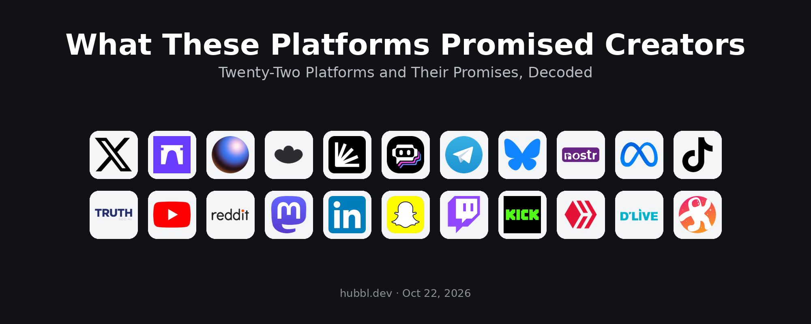
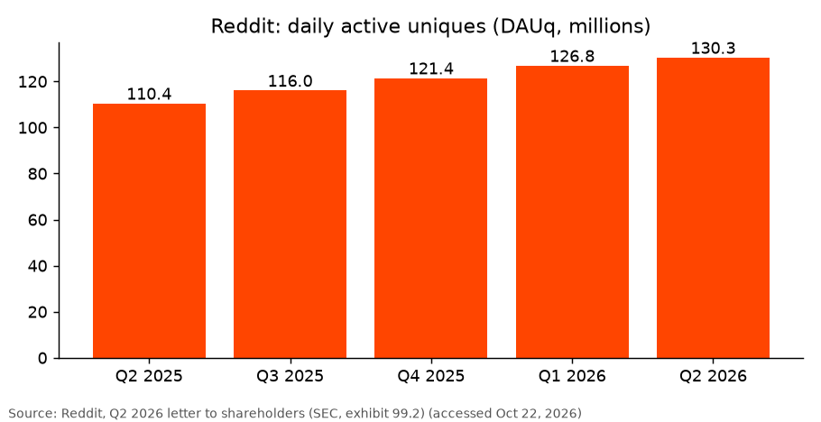
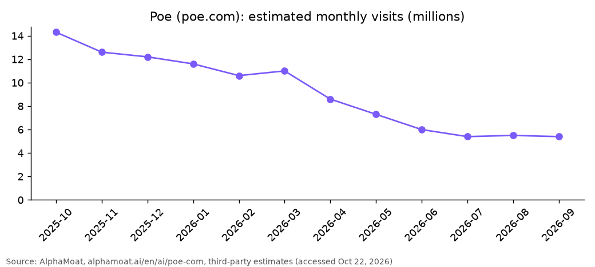
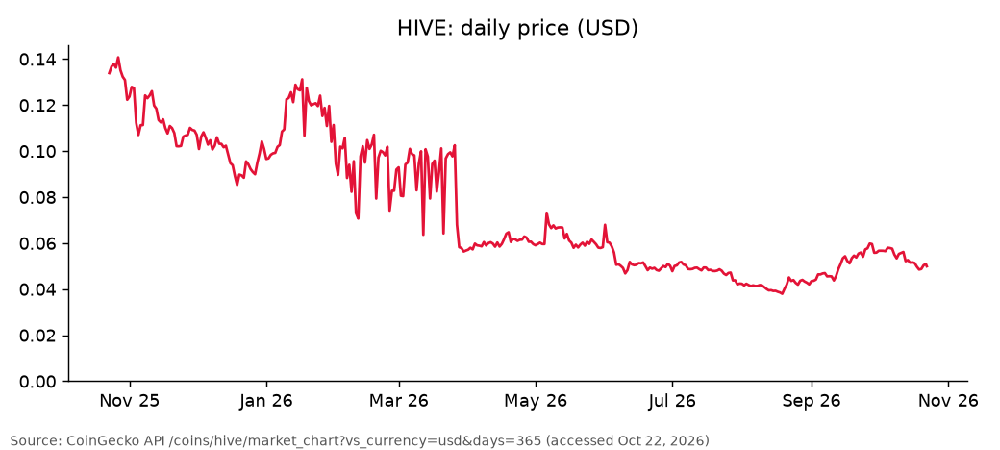
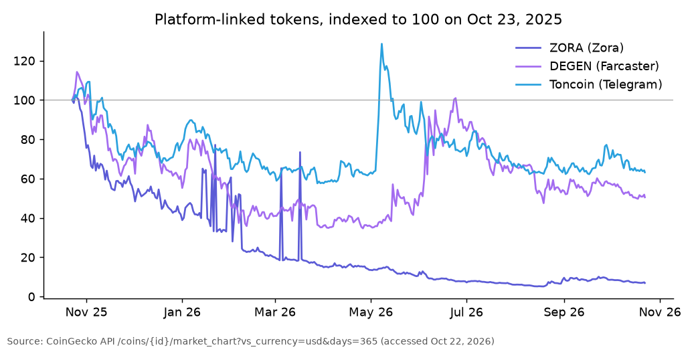
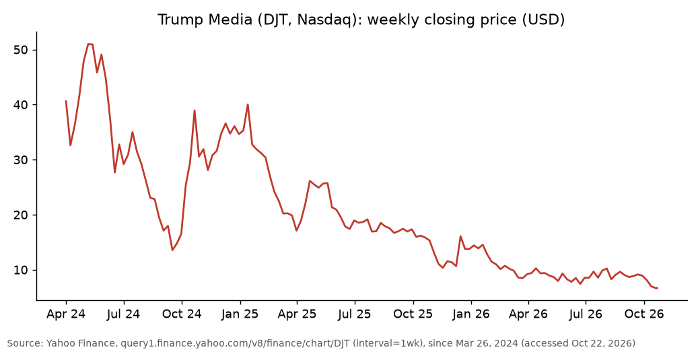
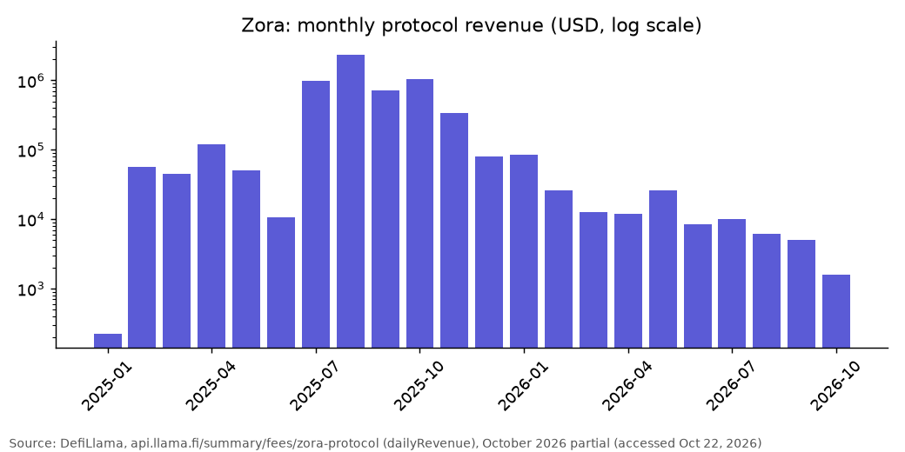
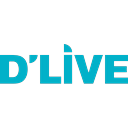
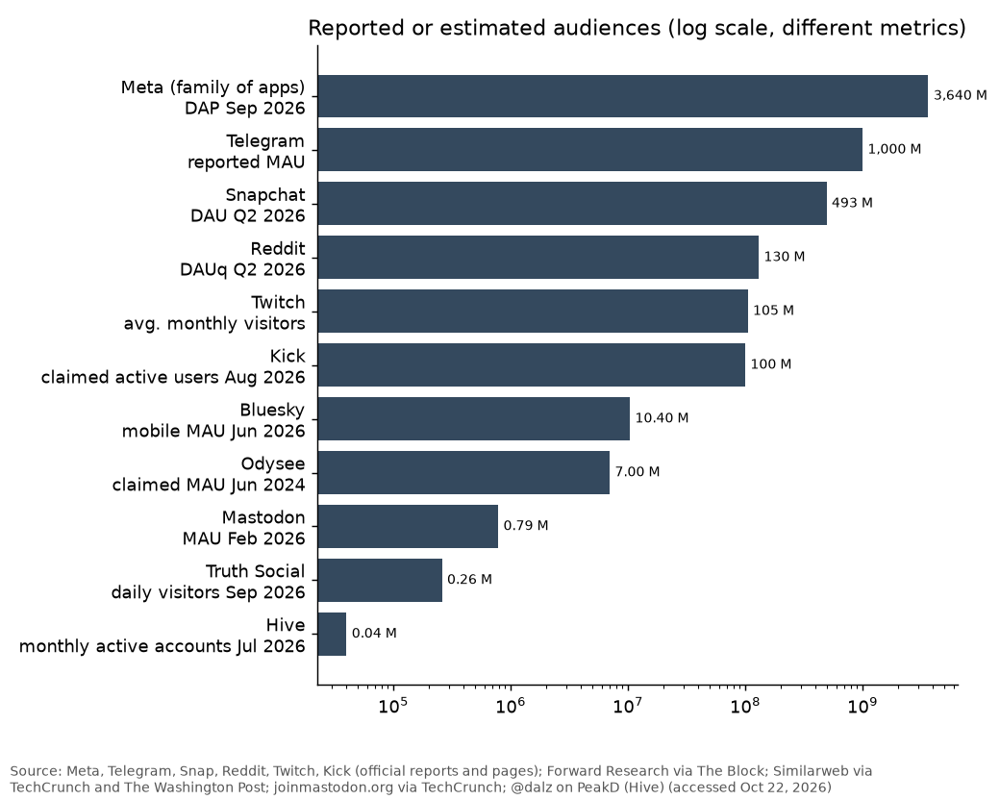

# What These Platforms Promised Creators

## Twenty-Two Platforms and Their Promises, Decoded

*How the scoring works: see [Method and verification](#method-and-verification) at the end.*

*hubbl.dev, Oct 22, 2026. Data accessed Oct 22, 2026.*

*Legend: ⬆️ growing, ⬇️ declining, ➖ stable. Each symbol reflects the sourced trend figure cited in the entry; entries without a reliable trend figure carry no symbol.*

*Scores out of 8 add four criteria rated 0 to 2 from the cited sources (automation not assessed); see Method and verification.*

You post, you run a community, you build a tool, and one question keeps coming back: which of these platforms will actually pay you? The promises have changed in two years. Some platforms have overhauled their payment programs, others have changed owners, and others turned every post into a financial asset before backing away from it.

This article reviews 22 platforms. For each one, you will find a dated timeline, how creator payments work, and where things stand in October 2026. Figures come from official documents when they exist. Third-party estimates are flagged as such. A ranking based on explicit criteria closes the piece, and the entries appear in the order of that ranking.

## Contents

1. [Meta (Facebook, Instagram, WhatsApp, Threads)](#1-meta--88)
2. [Reddit](#2-reddit--88)
3. [Snapchat](#3-snapchat--88)
4. [Telegram](#4-telegram--88)
5. [Kick](#5-kick--78)
6. [YouTube](#6-youtube--78)
7. [TikTok](#7-tiktok-68)
8. [Twitch](#8-twitch--68)
9. [LinkedIn](#9-linkedin--58)
10. [Odysee](#10-odysee-58)
11. [Poe](#11-poe--58)
12. [X](#12-x--58)
13. [Hive](#13-hive--48)
14. [Nostr](#14-nostr-48)
15. [Paragraph](#15-paragraph-48)
16. [Bluesky](#16-bluesky--38)
17. [Farcaster](#17-farcaster-28)
18. [Lens](#18-lens-28)
19. [Mastodon](#19-mastodon--28)
20. [Truth Social](#20-truth-social--28)
21. [Zora](#21-zora--28)
22. [DLive](#22-dlive-08)
23. [Ranking](#ranking)
24. [Sources](#sources)
    - [Method and verification](#method-and-verification)

---

## 1. Meta ⬆️ 8/8

During the week of Jan 26, 2026, Meta extended Threads ads to all markets [44]. In Q3 2026, the family of apps had 3.64 billion daily active people (+3% year over year), for revenue of $64.60B (+26%) [42]. Over the same period, Partnership Ads, ads made with creators, grew more than 97% and exceeded $15B in annualized revenue, more than 10 million creators were listed in the Creator Marketing Hub, and Meta One passed 15 million subscriptions and trials [43]. On the creator side, the revenue source Meta documented in Q3 2026 is therefore brand advertising, with Partnership Ads and the Creator Marketing Hub connecting advertisers and creators [43]. In October 2026, the group shows audience and revenue growth, and creator monetization runs mainly through advertisers.

### Facebook ⬆️

Time spent on Reels reached records, worldwide and in the United States, with double-digit year-over-year growth [43].

### Instagram ⬆️

Time spent per user reached a record, up double digits in Q3 2026, driven by Reels and the feed [43].

### WhatsApp

On Apr 30, 2025, Meta said WhatsApp had more than 3 billion monthly users [118]. Meta describes messaging records and a growing role for agents [43], without mentioning a creator payment program.

### Threads ⬆️

After its July 2023 launch, Threads lost about 70% of its daily active users in two weeks, down to about 13 million from the Jul 7, 2023 peak, according to Sensor Tower data cited by Fortune [107]. By Jan 7, 2026, Threads had 141.5 million mobile daily active users according to Similarweb, ahead of X [108]. Meta says Threads has passed X in monthly active users, without giving a figure, and time spent per user is up more than 20% year over year [43]. PPC Land reported 500 million monthly active users in Q2 2026 [44].

---

## 2. Reddit ⬆️ 8/8

On Jun 12, 2023, more than 8,000 subreddits went dark or read-only to protest Reddit's API pricing [112]; according to Similarweb, visits were down 7% on Jun 13, 2023 compared with an average day earlier in the year, before recovering as communities came back online [113]. On Sep 25, 2023, Reddit launched its Contributor Program, first in the United States [55]. Earnings depend on karma and gold received: according to the current rate table in Reddit Help, a contributor earns $0.009 per gold from 100 to 4,999 karma and $0.01 above 5,000 karma, with a $10 payout threshold and payment via Stripe [56]. In Q2 2026, Reddit had 130.3 million daily active uniques (+18%) and 514.6 million weekly, for revenue of $805M (+61%) [57]. In October 2026, audience and revenue growth remains strong [57][58], but the payment program remains modest relative to the platform's activity.

*Reddit: daily active uniques. Source and detailed data in the sources file.*

---

## 3. Snapchat ⬆️ 8/8

In Q1 2026, Snapchat had 956 million monthly active users and 483 million daily (+5%) [52]. Since May 7, 2026, 100 hours of Spotlight watch time over 28 days are required to earn maximum rewards [54]. In Q2 2026, the app reached 971 million monthly active users and 493 million daily, for revenue of $1.60B (+19%), and the number of people posting on Spotlight in the United States grew more than 115% [53]. The monetization program works by invitation, based on public criteria (50,000 followers, 15,000 watch hours over 28 days including 3,000 on Spotlight, Snap Star status), and shares revenue from ads inserted in public Stories and Spotlight, with withdrawals from $100 [54]. In October 2026, the audience is growing and investment in creators is on display.

---

## 4. Telegram ⬆️ 8/8

In 2024, Telegram added monthly subscriptions paid in Stars and Star Reactions, while the messaging app claimed 950 million active users [30]. In late August 2024, after the arrest of founder Pavel Durov, Telegram's global iOS downloads rose about 4% and the app climbed from No. 18 to No. 8 in the US App Store top apps chart, according to Appfigures data reported by TechCrunch [105]. On Mar 19, 2025, Durov said Telegram had more than 1 billion monthly active users, up from 950 million the previous year [104]. The same year, its revenue reached $1.4B for a first annual profit of $540M, according to figures relayed by a third-party statistics site [31]. In 2026, Telegram Ads claims 1 billion users and 1 trillion monthly views in public channels [29]. Owners of eligible channels can receive 50% of the revenue from ads shown in their channel, paid posts earn the equivalent of $0.013 per Star, and donations go through Star Reactions, with Telegram stating that these rewards can be changed or removed at any time [28][29]. In October 2026, the claimed audience is massive, but the sharing terms remain at Telegram's discretion [28], and Toncoin, the cryptocurrency linked to the ecosystem, has lost 36.8% over one year [11].

---

## 5. Kick ⬆️ 7/8

Kick is a social livestreaming platform. It opened in beta in December 2022, when streamer Trainwreck announced he was joining as a non-owner advisor and presented a 95/5 subscription split and 100% of tips for streamers [77]; Stake.com co-founders Ed Craven and Bijan Tehrani own the platform through their Australian company Easygo [78]. On Jun 17, 2023, Kick announced a two-year, non-exclusive deal with xQc, reported at $100M, and signed Amouranth in a deal reportedly worth $30M to $40M, then gained more than one million new users in the following days [79]; Adin Ross ranked among its most-watched streamers in Q3 2025 [124]. Kick keeps 5% of subscription and KICKs revenue as a processing fee, pays through Stripe, and you must be a Kick Affiliate or Partner to earn [80]. The Kick Partner Program, launched in 2024, requires 30 hours streamed and 250 unique chatters over 30 days, 25 active subscribers, 250 followers and an average of 75 concurrent viewers; streams in the gambling and Just Sleeping categories are demonetized, multistreaming earns 50% of the usual revenue, and Kick says the program has paid out more than $400M [81]. From Feb 1, 2025, gambling streams were limited to sites that verify users' age with ID [119], and on Feb 9, 2026 the Italian regulator AGCOM closed proceedings against Kick over videos promoting gambling, finding that the platform acted as a passive host [120]. In September 2026, after reported payout errors, Kick corrected the affected payments and moved Partner Program rates from a stream-by-stream calculation to a rolling window of recent streams, without changing the 95/5 split [121][122]. On Aug 7, 2026, Kick launched advertising and said it had more than 100 million active users, 39 million new users in 2025 and 27 million in the first half of 2026, and more than 41,000 creators streaming each month [123]. According to Streams Charts, Kick reached 2.04 billion hours watched in Q3 2026, up 30.7% from the previous quarter [75] and up 20% from 1.7 billion in Q3 2025 [124]. In October 2026, Kick is the fastest-growing major livestreaming platform tracked by Streams Charts, with a payout model that is still being adjusted [75][121].

---

## 6. YouTube ⬆️ 7/8

YouTube is a social video-sharing platform. On Jul 26, 2023, more than 2 billion logged-in users per month were watching Shorts [51]. On Sep 16, 2025, YouTube announced more than $100B paid to creators, artists and media companies since 2021 [49], in Q2 2026 YouTube ad revenue reached $11.06B, up 12.6% year over year [111], and in 2026 a YouTube executive told Variety that YouTube pays out "more than half" of its revenue to rights holders [50]. The YouTube Partner Program works in tiers: 500 subscribers and 3,000 watch hours (or 3 million Shorts views) unlock channel memberships, Super Chat and Shopping, then 1,000 subscribers and 4,000 hours (or 10 million Shorts views) unlock ad revenue sharing and Premium [48]. In October 2026, it is the oldest and best-documented program on this list, with no announced break in 2026.

---

## 7. TikTok 6/8

On Jan 22, 2026, TikTok USDS Joint Venture LLC was created in the United States: Oracle, Silver Lake and MGX each hold 15%, ByteDance keeps 19.9%, and TikTok claims more than 200 million Americans [45]. Earlier, on Jan 19, 2025, TikTok restored service in the United States after a brief interruption, once President-elect Donald Trump promised to pause the ban [109]; in the days before, more than 700,000 new users joined the Chinese app RedNote (Xiaohongshu) in two days, and its US downloads rose more than 200% year over year [110]. In January 2026, the first days of the new structure were marked by disruptions, including monetization tabs that temporarily disappeared for some creators [47]. On Jul 20, 2026, the Creator Rewards Program terms were updated in the United States [46]: you need 10,000 followers, 100,000 views over the last 30 days, a personal account in good standing and videos of at least one minute [46]. In October 2026, the program runs in the United States under the new joint venture, and no recent global audience data was found in the sources reviewed.

---

## 8. Twitch ⬇️ 6/8

Twitch is a social livestreaming platform. In October 2023, Twitch launched the Partner Plus Program, which raises the share of subscription revenue paid to streamers based on objective criteria [69]. On Jan 24, 2024, Twitch announced its expansion starting May 1, 2024: a 60/40 level for 100 Plus Points held for three consecutive months, a threshold lowered from 350 to 300 points for the 70/30 level, eligibility for Affiliates, and the immediate removal of the $100,000 cap above which the share reverted to 50% [69]. The program, renamed Plus Program, guarantees the improved share for 12 months from qualification [70]. Starting Jun 1, 2025, thresholds in Latin America were lowered to 50 points for 60/40 and 200 points for 70/30 [71]. On Feb 13, 2026, streamers including Kalei said they had lost their legacy 70/30 contract; Twitch replied that it honors these contracts without changing the payout structure, with the affected accounts moved to level 2 of the Plus Program [72]. Twitch claims more than 105 million average monthly visitors [76]. According to Streamlabs and Stream Hatchet, hours watched went from 5.27 billion in Q1 2025 to 4.55 billion in Q1 2026 (-13.68% year over year), then to 4.52 billion in Q2 2026 (-8.3% year over year) [73][74]. According to Streams Charts, whose method differs, Twitch reached 4.51 billion hours in Q3 2026 (+4% quarter over quarter), its best quarter since Q2 2025, while Kick grew 30.7% to 2.04 billion hours: Twitch generates about 2.2 times Kick's watch time, versus 2.8 times in Q2 [75]. These measurements describe activity on each service and do not directly measure viewers moving from one platform to another. In October 2026, Twitch remains far ahead of Kick in volume, with a shrinking annual decline and a competitor closing part of the gap [74][75].

---

## 9. LinkedIn ⬆️ 5/8

In April 2025, LinkedIn's Wire program became BrandLink and opened to creator shows [59], with a first cohort of 30 B2B creators and 13 publishers on Jun 2, 2025 [60]. BrandLink shares revenue from video ads placed before content, by invitation; LinkedIn does not publish the share paid out, and a publisher executive mentioned 50% to Business Insider, without confirmation from LinkedIn [59][60]. In 2026, BrandLink payments to creators go through Stripe and LinkedIn launched Top Voices 360 [61]. For the quarter ended June 2026, LinkedIn reported revenue up 12% year over year, full-year revenue of $19.8B, global membership growing at a double-digit rate for the fifth consecutive year and time spent on content up 10% year over year [116]. In October 2026, the program is expanding slowly and remains limited to selected creators and publishers.

---

## 10. Odysee 5/8

Odysee is a social video platform created in December 2020 on the LBRY blockchain [96]. In March 2021, the SEC sued LBRY Inc. over the unregistered sale of its LBC token, and in November 2022 a federal court in New Hampshire ruled in the SEC's favor [97][98]. In May 2023, the SEC asked to reduce the civil penalty from $22M to $111,614, as LBRY lacked sufficient funds [97]. On Oct 19, 2023, LBRY Inc. announced it was winding down: the LBRY network is not affected, Odysee and the other assets go through a legal process to pay debts, and LBRY dropped its appeal [97][98]. Odysee then had about 5.3 million monthly unique users, according to CoinGecko data cited by ForkLog [97]. On Jun 6, 2024, Forward Research, the main contributor to Arweave, acquired Odysee, which claimed more than 7 million monthly active users [99][100]. On May 27, 2025, Odysee unveiled Portal, a decentralized publishing platform [102]. In July 2025, Odysee replaced Stripe with a decentralized payment system in Arweave's AR token via Wander Wallet, with US dollar stablecoins planned: LBC tips ended on Jul 10, 2025, and paid memberships no longer renew automatically [101]. In October 2026, Odysee operates under Forward Research, with no recent official audience figure in the sources reviewed.

---

## 11. Poe ⬇️ 5/8

On Poe, a bot creator sets a price per message, up to $10,000 per 1,000 messages, and earns that price for each message the bot answers, with payment via Stripe [26]. The creator monetization FAQ was last updated on Jun 18, 2026, and the program is open only to creators based in the eligible regions listed by Poe [26]. From October 2025 to September 2026, estimated monthly visits went from 14.3 million to 5.4 million, or -62.3% according to a third-party estimate [27]. In October 2026, the program therefore exists, but the estimated audience has dropped sharply over twelve months [27].

*Poe: estimated monthly visits. Source and detailed data in the sources file.*

---

## 12. X ⬇️ 5/8

On Jul 13, 2023, Twitter made its first ad revenue sharing payments to verified creators, provided they had a Twitter Blue subscription, at least 5 million impressions in each of the previous three months, and a Stripe account [1]. As of Mar 31, 2026, the IPO filing of SpaceX, which owns X, reported 550 million monthly active users, versus 600 million claimed previously [5]. In April 2026, X cut payments to aggregator and "clickbait" accounts, then partly reversed those changes after protests [2]. New sign-ups for Creator Revenue Sharing closed on Aug 7, 2026 [3]. On Sep 2, 2026, payments to US creators moved to X Money as a requirement, while creators outside the United States stayed on Stripe [4]. The program ended on Sep 7, 2026, with a final payout around Sep 11, 2026 [3], and Original Content Rewards opened on Sep 8, 2026 [2][3]. The new program pays based on qualified impressions, meaning unique views from Premium subscribers in the home feed with at least 50% of the post visible: you must be 18, hold a Premium, Premium+ or Premium Business subscription, and have 500 verified followers and 500,000 impressions from verified accounts over 90 days; reposts, copied content and political or government accounts are excluded, and payouts are made every two weeks above a $30 threshold, in more than 100 announced countries [3]. In October 2026, the program has therefore just been replaced in favor of original content, with X calling the previous system "misaligned incentives" [2]. Reported audience remains high, but the March 2026 figure is below the previous claim, with measurement methods that are not necessarily comparable [5]. Third-party data points the same way: according to Similarweb, as reported by TechCrunch, X's mobile daily active users fell 7% year over year to 123.7 million in July 2026 and its mobile monthly active users fell about 3% to 302 million in June 2026, while web visits rose 5.3% to 4.7 billion in July [33]; in January 2026, Threads had 141.5 million mobile daily active users versus 125 million for X [108]. In SpaceX's quarterly report filed with the SEC, advertising revenue in the AI segment, which includes X, was $710M in the first half of 2026 versus $870M a year earlier, or -18.4% [103].

---

## 13. Hive ⬇️ 4/8

Hive is a social blockchain born from a fork of Steem. On Feb 14, 2020, Justin Sun's TRON Foundation acquired Steemit, the main Steem application [82][85]. In late February 2020, Steem witnesses activated soft fork 0.22.2 to freeze Steemit's "ninja-mined" stake, a freeze later reversed through votes from customer tokens held on exchanges (Binance, Huobi, Poloniex) [85][86]. On Mar 17, 2020, the Hive team announced the chain's launch for Mar 20, 2020 at 14:00 UTC, with an airdrop for all valid accounts [84][83], at 1 HIVE per 1 STEEM according to Binance [85], excluding Steemit's stake and, according to Onchain Atlas, accounts that had publicly supported the takeover [86]. Payment is written into the protocol: inflation, 9.5% per year starting in December 2016 and decreasing by about 0.5 point per year down to 0.95%, goes 65% to the author and curator reward pool, 15% to Hive Power holders, 10% to the proposal system (Decentralized Hive Fund) and 10% to witnesses; up to 50% of a post's payout goes to the curators who upvoted it, the other half to the author, and rewards can be claimed after 7 days [87]. The apps hive.blog, PeakD and Ecency and the game Splinterlands run on the chain [86]. According to an onchain analysis published on PeakD on Jul 20, 2026, daily activity went from about 30,000 to about 10,000 accounts after the 2020 fork, peaked near 500,000 accounts in 2021 with Splinterlands, then settled around 20,000 daily active accounts, of which about 1,600 post; monthly active accounts reached a record low of about 40,000, and accounts posting each month went from about 10,000 to about 5,000 in 2026 [88]. The HIVE token lost 62.7% between Oct 23, 2025 and Oct 22, 2026 and trades 98.5% below its record of $3.41 on Nov 25, 2021 [89]. In October 2026, Hive operates without a single owner, with an unchanged reward model but declining activity and price.

*HIVE: daily price. Source and detailed data in the sources file.*

---

## 14. Nostr 4/8

Nostr is a protocol, not a company: payment goes through zaps, Lightning payments in bitcoin. On Jun 16, 2026, D. Liberati published an analysis of zap concentration [36]: on a sample of five relays (about 3% of zaps), the median recipient received 100 sats over 90 days, and the most-zapped 1% captured 60.7% of the value [36]. The same analysis finds, for the February to May 2026 cohorts, retention of 1% to 2% of new users after one week and less than 1% after three weeks [36], as well as about 34,600 new public keys per day in April 2026, bots and bridge accounts included [36]. In October 2026, the protocol works, but retention remains very low and income highly concentrated [36][37].

---

## 15. Paragraph 4/8

On May 2, 2024, Paragraph announced a $5M raise and the acquisition of Mirror [25]. On Jul 15, 2025, the platform launched its coins, presented as "a version of coins that doesn't rely on speculation" [23], and on Nov 20, 2025 Writer Coins, which can be linked to a Zora creator coin [24]. Paragraph thus offers post and writer coins on Base [23][24]. On Dec 10, 2025, the platform said it had migrated nearly 1 million posts from more than 200,000 Mirror writers [117]. In April 2026, the platform presented payment for content by AI agents ("Your work, paid for by agents") [25], and its 2026 announcements focus on AI: publishing agents, an MCP server, native publishing to X Articles [25]. A point to note if you are considering these coins: the split of revenue and fees between the writer, the platform and other parties is not confirmed by any official source reviewed, so the figures circulating about this split are not repeated here. In October 2026, the platform keeps shipping features, mainly around AI and distribution, without publishing user or revenue figures.

---

## 16. Bluesky ⬇️ 3/8

On Feb 6, 2024, Bluesky ended invite codes and opened to the public [32]. After the November 2024 US election, Bluesky gained users leaving X and passed 20 million users on Nov 19, 2024 [106]. In June 2026, the network had 10.4 million monthly active users on mobile, or -27.2% year over year (Similarweb, via TechCrunch), for nearly 46 million registered accounts [33]. On Aug 27, 2026, according to Tech Times, Bluesky still paid creators nothing [34], and no native creator payment program exists in October 2026 [34]. On Oct 15, 2026, Bluesky announced plans to make buying, selling and fundraising easier on the network [35]. In October 2026, the active audience is declining while the company expands its projects beyond the app [33], and the announced transaction tools are not yet a payment program [35].

---

## 17. Farcaster 2/8

On Jan 21, 2026, Neynar announced the acquisition of Farcaster from Merkle Manufactory: Neynar took over the protocol, the clients and Clanker, and Merkle planned to return the $180M raised to investors [6]. On Jul 15, 2026, Jesse Pollak (Base) wrote that the whole social side, "farcaster, zora, miniapps, and yes, creator coins", had "disintegrated completely" [8]. On Oct 15, 2026, Network School, Balaji Srinivasan's organization, bought Farcaster from Neynar and renamed it Network State Protocol; users are offered a "social smart contract", and those who decline keep read access and can take their keys, funds, followers and history to another client [7]. Farcaster has not documented a creator payment program in the sources reviewed: income came through ecosystem mechanisms such as tips in the DEGEN token, and the Degen blog states that tip allowances end when the Degen App launches [10]. In October 2026, Farcaster is coming out of two ownership changes in nine months, with a new usage framework still to be defined, and the DEGEN token lost 49.5% between Oct 23, 2025 and Oct 22, 2026 [11].

*Platform-linked tokens, indexed to 100. Source and detailed data in the sources file.*

---

## 18. Lens 2/8

On Dec 18, 2024, Lens announced a $31M strategic raise led by Lightspeed Faction [20]. In November 2025, Hey.xyz, one of the main Lens clients, stopped active development [22]. On Jan 20, 2026, Mask Network became the steward of Lens, and Avara (Aave Labs) moved to a technical advisory role [21]. No native payment program appears in the sources reviewed: any income depends on the clients (apps) built on the protocol. In October 2026, the protocol is maintained under Mask Network's leadership, and no recent official activity figure was found.

---

## 19. Mastodon ➖ 2/8

Mastodon had its first public launch in October 2016 [38]. During the migration from Twitter, monthly active users on servers reporting to joinmastodon.org peaked at about 2.62 million on Nov 30, 2022, then fell to about 850,600 on Jul 31, 2024 and 765,714 on Jul 31, 2025, according to an archive of the official statistics [114]; the official statistics count 745,597 on Oct 22, 2026, or -2.6% compared with Jul 31, 2025 [115]. In early 2026, the organization announced its move to a nonprofit structure, Eugen Rochko stepped down from leadership and Felix Hlatky became executive director [39]. On Feb 18, 2026, Mastodon had between 750,000 and 1 million monthly active users depending on the source, about 785,000 according to the official site [39], and in April 2026 the organization signed a €614,000 contract with the Sovereign Tech Fund [40]. No creator payment program appears in the sources reviewed: the organization is funded by donations, Patreon (about 4,900 backers for more than $17,000 per month in February 2026) and grants [41], and TechCrunch reports plans for creator features [39]. In October 2026, Mastodon is an organization in restructuring, with an audience under one million monthly active users and no direct creator payments.

---

## 20. Truth Social ⬇️ 2/8

Trump Media (TMTG), which operates Truth Social, reported $3.6M in net sales in 2024 [62], then $3.7M in revenue in 2025 for a consolidated net loss of $712.3M, mostly tied to the decline in digital assets [63]. In Q2 2026, revenue was about $1.7M and the net loss $238.1M [64]. No creator payment program appears in the documents reviewed: TMTG makes money through advertising, Truth+ subscriptions and data sales [64][66], and said on Aug 11, 2026 that Wall Street firms pay up to $100,000 for early access to Donald Trump's posts [66]. On Oct 14, 2026, The Washington Post reported, based on Similarweb, about 260,000 daily users in September 2026, versus about 420,000 in June 2025 [65]. In October 2026, the audience is declining and revenue remains very low relative to the group's losses, while DJT stock has gone from $40.59 (week of Apr 1, 2024) to $6.66 (Oct 21, 2026) [67].

*Trump Media (DJT): weekly share price. Source and detailed data in the sources file.*

---

## 21. Zora ⬇️ 2/8

On Feb 21, 2025, Zora announced that posts would become tradable "coins", and NFT creation was later listed as a discontinued feature [12][13]. The ZORA token launched on Apr 23, 2025 [14], and every profile became a "creator coin" on Jun 20, 2025 [15]. Monthly protocol revenue peaked in August 2025, at $2.31M [19]. The model is simple: creator coins and content coins charge 1% on each trade, the creator receives 50% of those fees, or 0.5% of the traded amount, paid in ZORA, and the rest goes to referrers, the Zora protocol, Doppler and liquidity [16]. On Jul 15, 2026, daily volume was only $112,170, versus $63M at the April 2025 peak, or -99.8%, and daily creators fell from 32,286 on Feb 13, 2026 to 512 on Jul 15, 2026 [9]. On Aug 20, 2026, Zora launched Custom Pairs, pairs with ETH, USDC, Robinhood tokenized stocks or Solana tokens [17][13], on which the creator receives 0.70% out of 1% [13]. On Sep 9, 2026, Dee Goens replaced Jacob Horne as CEO, and the team has fewer than 10 people after layoffs [18]. In October 2026, monthly protocol revenue has gone from $2.31M (August 2025) to $5,008 (September 2026) [19], the ZORA token has lost 93.1% over one year [11], and Zora keeps shipping features (multichain, custom pairs) with a very small team.

*Zora: monthly protocol revenue. Source and detailed data in the sources file.*

---

## 22. DLive 0/8

DLive is a social livestreaming platform. It launched its beta on the Steem blockchain in December 2017, moved to the Lino blockchain testnet in September 2018, and hosted PewDiePie's first exclusive stream in April 2019 [91]. In December 2019, DLive formed a strategic partnership with BitTorrent, owned by Justin Sun since 2018 [91]; on Jan 8, 2020, BitTorrent announced that its BTT token would become the unit of value of the ecosystem and presented a system in which streamers and viewers earn tokens without sharing their earnings with the platform [90]. In April 2020, DLive launched BTT staking on the TRON blockchain, and on Oct 22, 2020 BitTorrent announced the acquisition of DLive, which then claimed 7 million active users and more than 200,000 active creators [91]. In January 2021, according to the Southern Poverty Law Center as cited by CoinDesk, DLive took 25% of each donation, 20% for the platform and 5% redistributed through staking; after footage of the Jan 6, 2021 breach of the Capitol was streamed on the platform, DLive suspended accounts, froze earnings and refunded donations and subscriptions [92]. On Apr 7, 2026, DLive announced the platform's shutdown and the immediate end of top-ups and subscriptions, asking users to withdraw their Coins, cancel their subscriptions and download their content; the mobile app was then taken offline [93][94]. In October 2026, the site states that DLive is no longer in operation [95].

---

## Ranking

### Criteria

Each platform receives 0 to 2 points on four criteria, for a total out of 8. Only data cited in the entries counts.

1. **Creator payment program open on public criteria.**
2. **Audience.**
3. **Audience trend over roughly 12 months.**
4. **Model stability in 2026.**

What earns 2, 1 or 0 on each criterion is defined in the scoring rubric under Method and verification.

### Results

| Rank | Platform | Program | Audience | Trend | Stability | Total /8 |
|---|---|---|---|---|---|---|
| 1 | Meta | 2 | 2 | 2 | 2 | 8 |
| 1 | Reddit | 2 | 2 | 2 | 2 | 8 |
| 1 | Snapchat | 2 | 2 | 2 | 2 | 8 |
| 1 | Telegram | 2 | 2 | 2 | 2 | 8 |
| 5 | Kick | 2 | 2 | 2 | 1 | 7 |
| 5 | YouTube | 2 | 2 | 1 | 2 | 7 |
| 7 | TikTok | 2 | 2 | 1 | 1 | 6 |
| 7 | Twitch | 2 | 2 | 0 | 2 | 6 |
| 9 | LinkedIn | 1 | 0 | 2 | 2 | 5 |
| 9 | Odysee | 1 | 1 | 1 | 2 | 5 |
| 9 | Poe | 2 | 1 | 0 | 2 | 5 |
| 9 | X | 2 | 2 | 0 | 1 | 5 |
| 13 | Hive | 2 | 0 | 0 | 2 | 4 |
| 13 | Nostr | 1 | 0 | 1 | 2 | 4 |
| 13 | Paragraph | 2 | 0 | 1 | 1 | 4 |
| 16 | Bluesky | 0 | 1 | 0 | 2 | 3 |
| 17 | Farcaster | 1 | 0 | 1 | 0 | 2 |
| 17 | Lens | 1 | 0 | 1 | 0 | 2 |
| 17 | Mastodon | 0 | 0 | 1 | 1 | 2 |
| 17 | Truth Social | 0 | 0 | 0 | 2 | 2 |
| 17 | Zora | 2 | 0 | 0 | 0 | 2 |
| 22 | DLive | 0 | 0 | 0 | 0 | 0 |

Platforms with equal scores are listed in alphabetical order.

Meta, Reddit, Snapchat and Telegram are tied for first with 8/8. DLive, shut down in April 2026, is last with 0/8, behind Farcaster, Lens, Mastodon, Truth Social and Zora (2/8 each).

**Rationale for debatable scores**

- X, trend at 0: mobile daily active users down 7% year over year in July 2026 according to Similarweb [33], consistent with the lower reported MAU of March 2026 [5].
- X, stability at 1: the program was replaced in September 2026 [2].
- TikTok, stability at 1: new ownership structure in the United States, without the program stopping [45][46].
- YouTube, trend at 1: the sourced growth figure is ad revenue (+12.6% in Q2 2026) [111], not audience, so the audience trend criterion stays undocumented.
- LinkedIn, trend at 2 and audience at 0: membership grows at a double-digit rate and time spent on content is up 10% [116], but LinkedIn publishes members, not active users.
- Mastodon, trend at 1: monthly active users down 2.6% between Jul 31, 2025 and Oct 22, 2026, which counts as stable [114][115].
- YouTube, audience at 2: the figure used (more than 2 billion logged-in users on Shorts) dates from 2023 [51].
- Telegram, trend at 2: monthly active users rose from 950 million to more than 1 billion between 2024 and March 2025 according to the founder; no more recent official comparison was found [104].
- Telegram, program at 2: ad revenue sharing open to eligible channels, but revocable at any time [28].
- Paragraph, stability at 1: announcements refocused on AI in 2026, with no stated abandonment of coins [25].
- Twitch, audience at 2: the figure used (more than 105 million average monthly visitors) appears on an undated official page [76].
- Twitch, trend at 0: hours watched down 8.3% year over year in Q2 2026, despite the quarterly increase in Q3 [74][75].
- Kick, audience at 2: the figure used is Kick's own claim of more than 100 million active users (Aug 7, 2026), without a stated period [123].
- Kick, stability at 1: the Partner Program rate calculation was overhauled in September 2026 after payout errors [121][122].
- Hive, stability at 2: no break in the reward model in 2026, despite declining activity and price [88][89].
- Odysee, audience at 1 and trend at 1: the 7 million monthly active users figure dates from June 2024 and no recent trend is documented [99].
- Odysee, stability at 2: the acquisition (2024) and the payment change (2025) predate 2026 [99][101].
- Farcaster, trend at 1: no sourced user or activity figure was found; the entry cites only a quote and the DEGEN token price, so the trend is undocumented [8][11].
- DLive, 0 across the board: the platform ceased operations in April 2026 [93][95].
- Zora, program at 2: the 0.5% share is documented and open to all, but activity has fallen 99.8% [9][16].

This ranking measures access to payment and the soundness of the platforms. It does not predict what you will earn.

*Reported or estimated audiences. Source and detailed data in the sources file.*

---

## Sources

### Method and verification

All sources were accessed on Oct 22, 2026. Of the 124 entries in the list below, 72 carry a precise publication or update date, 19 an approximate date (month or year only) and 33 no date (documentation pages, APIs, permanent pages and logos). These labels appear identically in the sources file.

Several claims were dropped for lack of a primary source: the renaming of Warpcast to Farcaster in May 2025, a drop in Lens daily activity from 42,000 to about 8,000 users (only source: an unpaid contributor op-ed), a Nostr daily audience of 30,000 to 36,000 users, and audience figures relayed only by third-party sites: 240 million monthly active users on Twitch and 11 million monthly visits to Odysee in November 2025. The revenue and fee split of Paragraph coins is not confirmed by any official source reviewed and is therefore not quantified. Third-party estimates (Similarweb, AlphaMoat, DemandSage, CoinGecko, DefiLlama, Streamlabs and Stream Hatchet, Streams Charts) are flagged as such in the entries.

**Scoring rubric (score out of 8).** The score out of 8 adds four criteria, each rated 0, 1 or 2. Scores are judged from the sources cited in the entries, not from direct measurements of the platforms. Automation (for example bots, automated posting or AI tooling) was not assessed and does not count toward the score out of 8, which rests only on these four criteria.

- **Creator payment program open on public criteria.** 2: a payout mechanism run by the platform or written into its protocol (ad or subscription revenue sharing, rewards, a share of fees on creator coins, a price per message) that you can join by meeting published criteria, even when the last step is an invitation based on those criteria. 1: a program reserved for creators selected by invitation, or income limited to direct support from users (tips, donations, memberships) or left to third-party apps built on the protocol. 0: no documented program, or a program that has ended.
- **Audience.** 2: at least 100 million users on a published measure of active use (monthly or daily active users, logged-in users, monthly visitors). 1: from 1 million to 100 million. 0: under 1 million, or no sourced figure of active use. Member and registered-account counts are not measures of active use. Older or undated official figures are used when no recent one exists.
- **Audience trend over roughly 12 months.** 2: documented growth in users or engagement (time spent, membership). 1: a change within about 3% either way, or no documented audience trend; a revenue figure alone leaves this criterion at 1. 0: a documented decline in users or activity (visits, hours watched, active accounts, trading activity).
- **Model stability in 2026.** 2: no documented break in 2026; earlier changes do not count. 1: an overhaul of the payment program or of the organization, a change of focus, or new ownership in one market, with the program still running. 0: a change of owner or steward of the platform or protocol, a collapse in activity, a major pivot, or a shutdown.

Rules applied to every score: with no sourced figure, audience scores 0 and trend scores 1 (undocumented); a platform that has ceased operations scores 0 on all four criteria. Official figures come first. When no official figure exists, estimates from measurement firms (Similarweb, Sensor Tower, Streamlabs and Stream Hatchet, Streams Charts) are used and flagged as such in the entry; figures relayed only by statistics or aggregator sites, without a primary source, are not scored.

The trend symbols next to the headings (⬆️ growing, ⬇️ declining, ➖ stable) follow one rule: each symbol is justified by a sourced trend figure on audience, activity or revenue over roughly the last 12 months that is already cited in the entry, with audience or activity preferred. Stable (➖) is used only when the sourced change is within about 3% either way. Entries without such a figure carry no symbol; stable is never used as a default. A symbol based on revenue does not change the audience trend score in the ranking.

### Source list

1. TechCrunch, "Twitter starts sharing ad revenue with verified creators", Jul 13, 2023. https://techcrunch.com/2023/07/13/twitter-starts-sharing-ad-revenue-with-verified-creators/
2. TechCrunch, "X replaces 'misaligned' revenue sharing program with Original Content Rewards", Aug 8, 2026. https://techcrunch.com/2026/08/08/x-replaces-misaligned-revenue-sharing-program-with-original-content-rewards/
3. Net Influencer, "X Details Eligibility Rules For New Original Content Rewards Program", August 2026, approximate date. https://www.netinfluencer.com/x-details-eligibility-rules-for-new-original-content-rewards-program/
4. TechCrunch, "X shifts US creator payouts from Stripe to X Money", Sep 2, 2026. https://techcrunch.com/2026/09/02/x-shifts-us-creator-payouts-from-stripe-to-x-money/
5. Social Media Today, "SpaceX filing provides insight into X, Grok and xAI", 2026, approximate date. https://www.socialmediatoday.com/news/spacex-filing-provides-insight-into-x-grok-and-xai/820945/
6. Neynar, "Neynar is acquiring Farcaster", Jan 21, 2026. https://neynar.com/blog/neynar-is-acquiring-farcaster
7. The Block, "Farcaster acquired by Balaji's Network School, with new 'social smart contract' for users", Oct 15, 2026. https://www.theblock.co/news/ecosystems/2026-10-15-network-school-acquires-farcaster-from-neynar-418720
8. Decrypt, "Base Creator Jesse Pollak Steps Back From App Leadership After Admitting Social Bet 'Was Wrong'", Jul 15, 2026. https://decrypt.co/373574
9. BeInCrypto, "Jesse Pollak Admits His Onchain Social Bet Failed, Hands Base App to Coinbase", Jul 16, 2026 (Dune data, Zora team dashboard). https://beincrypto.com/jesse-pollak-base-zora-social-bet/
10. Degen, "Degen App sneak peak", official blog, date not stated. https://blog.degen.tips/degen-app-sneak-peak
11. CoinGecko API, /coins/{zora, degen-base, the-open-network}/market_chart, 365 days, USD, date not stated. https://api.coingecko.com/api/v3/coins/zora/market_chart?vs_currency=usd&days=365&interval=daily
12. Zora on X, Feb 21, 2025. https://x.com/zora/status/1893005253827797267
13. Zora Help Center, "What has changed on Zora?", modified Aug 12, 2026. https://support.zora.co/en/articles/4641857
14. Zora on X, "$ZORA is live", Apr 23, 2025. https://x.com/zora/status/1915060861095256356
15. Zora on X, Creator Coins, Jun 20, 2025. https://x.com/zora/status/1936096447864488277
16. Zora Docs, "Coin Rewards", date not stated. https://docs.zora.co/coins/contracts/rewards
17. Zora on X, Custom Pairs, Aug 20, 2026. https://x.com/zora/status/2090563237758521387
18. The Defiant, "Zora Co-Founder Dee Goens Replaces Jacob Horne as CEO", Sep 9, 2026. https://thedefiant.io/news/defi/zora-co-founder-dee-goens-replaces-jacob-horne-as-ceo
19. DefiLlama API, zora-protocol, dailyRevenue, date not stated. https://api.llama.fi/summary/fees/zora-protocol?dataType=dailyRevenue
20. Lens, "Lens closes $31 million strategic raise", Dec 18, 2024. https://lens.xyz/news/lens-closes-31-million-strategic-raise
21. Lens, "Mask Network to steward the next chapter of Lens", Jan 20, 2026. https://lens.xyz/news/mask-network-to-steward-the-next-chapter-of-lens
22. Hey.xyz, founder's post, November 2025, approximate date. https://hey.xyz/posts/3gwen864ffvwwfrb9r6
23. Paragraph, "Introducing Coins on Paragraph", Jul 15, 2025. https://paragraph.com/@blog/coins
24. Paragraph, "Writer Coins", Nov 20, 2025. https://paragraph.com/@blog/writer-coins
25. Paragraph, official blog (2024 to 2026 announcements), date not stated. https://paragraph.com/@blog
26. Poe Help Center, "Poe Creator Monetization FAQs", updated Jun 18, 2026. https://help.poe.com/hc/en-us/articles/21921312368020-Poe-Creator-Monetization-FAQs
27. AlphaMoat, "Poe Traffic & Stats (Sep 2026)", third-party estimates, date not stated. https://www.alphamoat.ai/en/ai/poe-com
28. Telegram, "Terms of Service for Content Creators", date not stated. https://telegram.org/tos/content-creator-rewards
29. Telegram Ads, "Telegram Ads", date not stated. https://ads.telegram.org/basics
30. Yahoo News, "Telegram adds new ways for creators to earn money on its platform", 2024, approximate date. https://www.yahoo.com/news/telegram-adds-ways-creators-earn-153804575.html
31. DemandSage, "Telegram Users Statistics 2026", third-party estimates, date not stated. https://www.demandsage.com/telegram-statistics/
32. Bluesky, "Join Bluesky Today (Bye, Invites!)", Feb 6, 2024. https://bsky.social/about/blog/02-06-2024-join-bluesky
33. TechCrunch, "Bluesky's active user base is shrinking as its focus expands beyond the app", Aug 11, 2026. https://techcrunch.com/2026/08/11/blueskys-active-user-base-is-shrinking-as-its-focus-expands-beyond-the-app/
34. Tech Times, "Bluesky Matches TikTok on Video Length but Still Pays Creators Nothing", Aug 27, 2026. https://www.techtimes.com/articles/325740/20260827/bluesky-matches-tiktok-video-length-still-pays-creators-nothing.htm
35. TechCrunch, "Bluesky wants to make it easier to buy, sell, and fundraise on the network", Oct 15, 2026. https://techcrunch.com/2026/10/15/bluesky-wants-to-make-it-easier-to-buy-sell-and-fundraise-on-the-network/
36. D. Liberati, "Nostr's Retention Problem: A Structural Diagnosis", Jun 16, 2026. https://daniella.io/nostr-retention-structural-diagnosis/
37. Nostr Stats (And Other Stuff), date not stated. https://stats.andotherstuff.org/
38. Mastodon, "About", date not stated. https://joinmastodon.org/about
39. TechCrunch, "Mastodon, a decentralized alternative to X, plans to target creators with new features", Feb 18, 2026. https://techcrunch.com/2026/02/18/mastodon-a-decentralized-alternative-to-x-plans-to-target-creators-with-new-features/
40. Mastodon Blog, "Sovereign Tech Agency funding", April 2026, approximate date. https://blog.joinmastodon.org/2026/04/sovereign-tech-agency-funding/
41. Investopedia, "How Mastodon Makes Money", date not stated. https://www.investopedia.com/how-mastodon-makes-money-7482865
42. Meta, "Meta Reports Third Quarter 2026 Results", October 2026, approximate date. https://investor.atmeta.com/investor-news/press-release-details/2026/Meta-Reports-Third-Quarter-2026-Results/default.aspx
43. Meta, "Q3 2026 Prepared Remarks", October 2026, approximate date. https://s21.q4cdn.com/399680738/files/content_files/META-Q3-2026-Prepared-Remarks.pdf
44. PPC Land, "Meta's ads with creators gain 97% to a $15bn annual run rate", October 2026, approximate date. https://ppc.land/metas-ads-with-creators-gain-97-to-a-15bn-annual-run-rate/
45. TikTok Newsroom, "Announcement from the new TikTok USDS Joint Venture LLC", Jan 22, 2026. https://newsroom.tiktok.com/announcement-from-the-new-tiktok-usds-joint-venture-llc?lang=en
46. TikTok, "Creator Rewards Program Terms", updated Jul 20, 2026. https://www.tiktok.com/legal/page/global/creator-rewards-program-us/en
47. Digiday, "The first few days of TikTok's new ownership have been chaotic", January 2026, approximate date. https://digiday.com/media/tiktoks-ownership-shake-up-sends-creators-scrambling-amid-chaos-and-uncertainty/
48. YouTube for Creators, "Join the YouTube Partner Program", date not stated. https://www.youtube.com/creators/earn/youtube-partner-program/
49. CNBC, "YouTube says it has paid creators more than $100 billion over last 4 years", Sep 16, 2025. https://www.cnbc.com/2025/09/16/youtube-creators-pay.html
50. Variety, "YouTube Exec Counters Netflix Rivalry Talk, Highlights Platform's Reach", 2026, approximate date. https://variety.com/2026/digital/news/youtube-netflix-platforms-reach-100-billion-creators-economy-1236698769/
51. Techmeme (TechCrunch), "Google says 2B+ logged-in monthly users are watching YouTube Shorts", Jul 26, 2023. https://techmeme.com/230726/p3
52. Snap Inc., "Snap Inc. Announces First Quarter 2026 Financial Results", date not stated. https://investor.snap.com/news/news-details/2026/Snap-Inc--Announces-First-Quarter-2026-Financial-Results/
53. Snap Inc., "Q2 2026 Prepared Remarks" (SEC filing 0001564408-26-000047) and "Snap Inc. Announces Second Quarter 2026 Financial Results", date not stated. https://investor.snap.com/news/news-details/2026/Snap-Inc--Announces-Second-Quarter-2026-Financial-Results/default.aspx
54. Snapchat Support, "About Snapchat's Monetization Program", date not stated. https://help.snapchat.com/hc/en-us/articles/14669003687444-About-Snapchat-s-Monetization-Program
55. Reddit, "Updating Reddit Gold and Rolling Out Our New Contributor Program", Sep 25, 2023. https://redditinc.com/news/updating-reddit-gold-and-rolling-out-our-new-contributor-program
56. Reddit Help, "Understanding Contributor Earnings & Payouts", date not stated. https://support.reddithelp.com/hc/en-us/articles/17331720493972-Understanding-Contributor-Earnings-Payouts
57. Reddit, "Reddit Reports Second Quarter 2026 Results" (SEC), date not stated. https://www.sec.gov/Archives/edgar/data/1713445/000171344526000098/earningspressreleaseq226.htm
58. Reddit, "Q2 2026 Letter to Shareholders" (SEC, exhibit 99.2), date not stated. https://www.sec.gov/Archives/edgar/data/1713445/000171344526000098/exhibit992q226.htm
59. Business Insider, "LinkedIn Courts Creators With New Slate of Video Shows", April 2025, approximate date. https://www.businessinsider.com/linkedin-courts-creators-with-new-slate-of-video-shows-2025-4
60. Buzz in Content, "LinkedIn to share ad revenue with creators in new video monetisation push", 2025, approximate date. https://www.buzzincontent.com/news/linkedin-to-share-ad-revenue-with-creators-in-new-video-monetisation-push-9024724
61. LinkedIn News, "How LinkedIn is helping B2B marketers reach audiences at scale with creators and video", 2026, approximate date. https://news.linkedin.com/2026/how-linkedin-is-helping-b2b-marketers-reach-audiences-at-scale-w
62. TMTG, "TMTG Reports Full-Year 2024 Results", Feb 14, 2025 (SEC, exhibit 99.1). https://www.sec.gov/Archives/edgar/data/1849635/000114036125004799/ef20043654_ex99-1.htm
63. TMTG, "Trump Media & Technology Group Reports Full-Year 2025 Results", Feb 27, 2026 (SEC, exhibit 99.1). https://www.sec.gov/Archives/edgar/data/1849635/000114036126007171/ef20066676_ex99-1.htm
64. TMTG, Form 10-Q for the period ended Jun 30, 2026 (SEC), date not stated. https://www.sec.gov/Archives/edgar/data/1849635/000143774926026777/djt20260630_10q.htm
65. The Washington Post, "Trump's Truth Social faces a sharp decline in traffic", Oct 14, 2026. https://www.washingtonpost.com/politics/2026/10/14/trumps-truth-social-faces-sharp-decline-traffic/
66. CNN Business, "Trump Media says Wall Street firms paying up to $100K for early access to Trump Truth Social posts", Aug 11, 2026. https://www.cnn.com/2026/08/11/business/wall-street-trump-truth-social
67. Yahoo Finance, DJT chart API, weekly interval, date not stated. https://query1.finance.yahoo.com/v8/finance/chart/DJT?range=5y&interval=1wk
68. Logos: Wikimedia Commons (X, Telegram, Bluesky, Nostr, Mastodon, Meta, Facebook, Instagram, WhatsApp, Threads, TikTok, YouTube, Snapchat, Reddit, LinkedIn, Truth Social, Twitch, Kick, Hive, DLive, Odysee) and official sites (farcaster.xyz, zora.co, lens.xyz, paragraph.com, poe.com). File details in the sources file, date not stated.
69. Twitch Blog, "An Update to Several Streamer Payout Programs", Jan 24, 2024. https://blog.twitch.tv/en/2024/01/24/an-update-to-several-streamer-payout-programs/
70. Twitch Help, "The Plus Program", date not stated. https://help.twitch.tv/s/article/plus-program
71. Twitch Blog, "Supporting Streamers in Latin America", May 19, 2025. https://blog.twitch.tv/en/2025/05/19/supporting-streamers-in-latin-america/
72. Dexerto, "Twitch responds to claims they removed streamers' 70/30 sub split", Feb 13, 2026. https://www.dexerto.com/twitch/twitch-responds-after-kalei-slams-platform-for-taking-away-her-70-30-sub-split-3319057/
73. Streamlabs, "Streamlabs x Stream Hatchet Q1 2026 Live Streaming Report", 2026, approximate date. https://streamlabs.com/content-hub/post/streamlabs-and-stream-hatchet-q1-2026-live-streaming-report
74. Streamlabs, "Streamlabs and Hatchet Q2 2026 Live Streaming Report", 2026, approximate date. https://streamlabs.com/content-hub/post/streamlabs-and-hatchet-q2-2026-live-streaming-report
75. Streams Charts, "Q3 2026 Global Livestreaming Landscape", October 2026, approximate date. https://streamscharts.com/news/q3-2026-global-livestreaming-landscape
76. Twitch, "Press Center", date not stated. https://www.twitch.tv/p/press-center
77. Tubefilter, "Trainwreck announces Twitch challenger Kick, which might be a Stake.com gamble", Dec 6, 2022. https://www.tubefilter.com/2022/12/06/trainwreck-twitch-competitor-kick-stake-gambling/
78. Forbes, "Kick vs. Twitch: Inside Streaming's Billion-Dollar Death Match", Jul 15, 2023. https://www.forbes.com/sites/mattcraig/2023/07/15/kick-vs-twitch-inside-streamings-billion-dollar-death-match-xqc-amouranth-ed-craven-stake/
79. Tubefilter, "Kick signs $100 million deal with xQc, signs Amouranth, gets one million new users", Jun 20, 2023. https://www.tubefilter.com/2023/06/20/kick-xqc-amouranth-deals/
80. Kick Help Center, "Understanding KICK's revenue split", date not stated. https://help.kick.com/en/articles/15159722-understanding-kick-s-revenue-split
81. Kick, "The KICK Partner Program", date not stated. https://streamer.kick.com/partner
82. Business Wire, "Steemit Joining TRON Ecosystem", Feb 14, 2020. https://www.businesswire.com/news/home/20200214005129/en/Steemit-Joining-TRON-Ecosystem
83. CoinDesk, "Steem Community Plans Hostile Hard Fork to Flee Justin Sun's Steemit", Mar 17, 2020. https://www.coindesk.com/tech/2020/03/17/steem-community-plans-hostile-hard-fork-to-flee-justin-suns-steemit
84. Hive (@hiveio), "Announcing the Launch of Hive Blockchain", Mar 17, 2020. https://hive.blog/communityfork/@hiveio/announcing-the-launch-of-hive-blockchain
85. CoinDesk, "Steem Hard Forks Today Over Fears of Justin Sun Power Grab", Mar 20, 2020. https://www.coindesk.com/markets/2020/03/20/steem-hard-forks-today-over-fears-of-justin-sun-power-grab
86. Onchain Atlas, "Hive, history and analysis", third-party source, date not stated. https://www.onchainatlas.org/hive/history/
87. Hive.blog, "FAQ", date not stated. https://hive.blog/faq.html
88. @dalz on PeakD, "Active Hive Accounts by Category | Posts, Votes, Transfers, Custom JSON | July 2026", Jul 20, 2026. https://peakd.com/@dalz/active-hive-accounts-by-category-or-posts-votes-transfers-custom-json-or-july-2026
89. CoinGecko API, /coins/hive and /coins/hive/market_chart, 365 days, USD, date not stated. https://api.coingecko.com/api/v3/coins/hive/market_chart?vs_currency=usd&days=365&interval=daily
90. BitTorrent Blog, "DLive Joins BitTorrent Ecosystem", Jan 8, 2020. https://www.bittorrent.com/blog/2020/01/08/dlive-joins-bittorrent-ecosystem
91. Business Wire, "BitTorrent Announces DLive Acquisition and New BitTorrent X Ecosystem", Oct 22, 2020. https://www.businesswire.com/news/home/20201022005415/en/BitTorrent-Announces-DLive-Acquisition-and-New-BitTorrent-X-Ecosystem
92. CoinDesk, "Tron-Owned Video Platform Criticized for Hosting Extremists, US Capitol Rioters", Jan 8, 2021. https://www.coindesk.com/policy/2021/01/08/tron-owned-video-platform-criticized-for-hosting-extremists-us-capitol-rioters
93. DLive Community, "Important Announcement: DLive Platform Closure", Apr 7, 2026. https://community.dlive.tv/important-announcement-dlive-platform-closure/
94. Dexerto, "Twitch competitor DLive closes down after 8 years", Apr 7, 2026. https://www.dexerto.com/entertainment/twitch-competitor-dlive-closes-down-after-8-years-3347823/
95. DLive, "DLive Service Discontinued", date not stated. https://dlive.io/
96. Wikipedia, "Odysee", third-party source, date not stated. https://en.wikipedia.org/wiki/Odysee
97. ForkLog, "Regulated to oblivion. Blockchain startup LBRY shuts down after SEC battle", Oct 20, 2023. https://forklog.com/en/regulated-to-oblivion-blockchain-startup-lbry-shuts-down-after-sec-battle/
98. Bloomberg Law, "LBRY, Winding Down, Drops Appeal of Crypto Ruling for SEC", Oct 23, 2023. https://news.bloomberglaw.com/litigation/lbry-winding-down-drops-appeal-of-crypto-ruling-favoring-sec
99. The Block, "Decentralized YouTube alternative Odysee acquired by Forward Research despite content concerns", Jun 6, 2024. https://www.theblock.co/news/business/2024-06-06-decentralized-youtube-alternative-odysee-acquired-by-forward-research-despite-content-concerns-298888
100. DL News, "Arweave acquires crypto social media app Odysee: 'We haven't won until it replaces Twitter'", Jun 6, 2024. https://www.dlnews.com/articles/web3/arweave-acquires-crypto-social-media-app-odysee-we-havent-won-until-it-replaces-twitter/
101. Reclaim The Net, "Odysee Launches Decentralized Payment System", Jul 5, 2025. https://reclaimthenet.org/odysee-decentralized-payments-arweave-wander-wallet-lbc-phaseout
102. Business Wire, "Odysee Unveils 'Portal' with Independent Media Alliance as Flagship Partner for New Decentralized Publishing Platform", May 27, 2025. https://www.businesswire.com/news/home/20250527428788/en/Odysee-Unveils-Portal-with-Independent-Media-Alliance-as-Flagship-Partner-for-New-Decentralized-Publishing-Platform
103. SpaceX, Form 10-Q for the quarter ended Jun 30, 2026 (SEC), revenue disaggregation (R49), Aug 4, 2026. https://www.sec.gov/Archives/edgar/data/1181412/000162828026052535/R49.htm
104. TechCrunch, "Telegram founder Pavel Durov says app now has 1B users, calls WhatsApp a 'cheap, watered down imitation'", Mar 19, 2025. https://techcrunch.com/2025/03/19/telegram-founder-pavel-durov-says-app-now-has-1b-users-calls-whatsapp-a-cheap-watered-down-imitation/
105. TechCrunch, "Durov arrest boosts Telegram app downloads", Aug 26, 2024. https://techcrunch.com/2024/08/26/durov-arrest-boosts-telegram-app-downloads/
106. TechCrunch, "Bluesky tops 20M users, narrowing gap with Instagram Threads", Nov 19, 2024. https://techcrunch.com/2024/11/19/bluesky-tops-20m-users-narrowing-gap-with-instagram-threads/
107. Fortune, "Threads active users continue to tumble", Jul 21, 2023. https://fortune.com/2023/07/21/threads-traffic-down-70-percent-two-weeks-meta-musk-zuckerberg/
108. TechCrunch, "Threads edges out X in daily mobile users, new data shows", Jan 18, 2026. https://techcrunch.com/2026/01/18/threads-edges-out-x-in-daily-mobile-users-new-data-shows/
109. NPR, "TikTok is back online in the U.S., following Trump's promise to pause the ban", Jan 19, 2025. https://www.npr.org/2025/01/19/nx-s1-5267568/tiktok-back-online
110. The Guardian, "More than half a million 'TikTok refugees' flock to China's RedNote as ban looms", Jan 14, 2025. https://www.theguardian.com/technology/2025/jan/14/tiktok-ban-rednote-app
111. Variety, "YouTube Ad Sales Increase 13% in Q2 2026: Alphabet Earnings Results", Jul 22, 2026. https://variety.com/2026/digital/news/youtube-q2-2026-ad-sales-alphabet-google-earnings-results-1236818132/
112. TechCrunch, "Thousands of subreddits go dark to protest Reddit's API pricing", Jun 12, 2023. https://techcrunch.com/2023/06/12/reddit-blackout-8000-subreddits-went-dark-protest-api/
113. Similarweb, "Reddit Captures 7% to 16% Less Audience Time During Blackout", Jun 19, 2023. https://www.similarweb.com/blog/insights/social-media-news/reddit-blackout/
114. Network Pulse, "Mastodon User Stats: Monthly Active Users, Signups & Growth", third-party archive of joinmastodon.org statistics, date not stated. https://obsesivegamer.github.io/Mastodon-User-Trends/
115. joinmastodon.org, statistics API (daily active_user_count), date not stated. https://api.joinmastodon.org/statistics
116. LinkedIn News, "Q4 Earnings & Business Highlights", July 2026, approximate date. https://news.linkedin.com/2026/q4-earnings-and-business-highlights
117. Paragraph, "Better discovery for readers, more reach for writers", Dec 10, 2025. https://paragraph.com/@blog/better-discovery
118. TechCrunch, "WhatsApp now has more than 3 billion users a month", May 1, 2025. https://techcrunch.com/2025/05/01/whatsapp-now-has-more-than-3-billion-users/
119. EGR Intel, "Kick amends gambling-related streams to better protect customers", Nov 29, 2024. https://www.egr.global/intel/news/kick-amends-gambling-related-streams-to-better-protect-customers/
120. PressGiochi, "AGCOM dismisses proceedings against Kick for alleged violation of gaming advertising ban", Feb 9, 2026. https://www.pressgiochi.it/en/agcom-archivia-il-procedimento-contro-kick-per-presunta-violazione-del-divieto-di-pubblicita-ai-giochi/145795
121. Win.gg, "Kick Admits KPP Payment Errors", Sep 22, 2026. https://win.gg/kick-admits-kpp-payment-errors/
122. Kick Help Center, "How We Calculate KPP Rates", September 2026, approximate date. https://help.kick.com/en/articles/17225591-how-we-calculate-kpp-rates
123. Kick, "KICK Goes Live With Ads: The Direct Line to Gen Z Brands Have Been Looking For", Aug 7, 2026. https://about.kick.com/news-and-press/12-kick-goes-live-with-ads-the-direct-line-to-gen-z-brands-have-been-looking-for
124. Streams Charts, "Q3 2025 Livestreaming Trends: YouTube, TikTok, Twitch & Rising Platforms", October 2025, approximate date. https://streamscharts.com/news/q3-2025-global-livestreaming-landscape

> **Where the data comes from.** All data, figures and timelines in this article come from the dedicated sources file: [sources-article-plateformes-2026-10-22.md](sources-article-plateformes-2026-10-22.md). There you will find, platform by platform, each data point with its source, publication date, link and access date, as well as the raw series used for the charts.

---

PS: I did the work so you don't have to. Cite me anyway.
